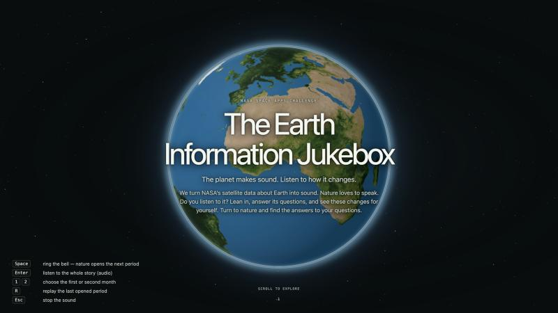
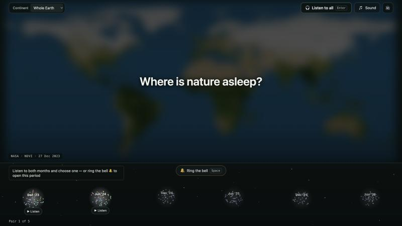
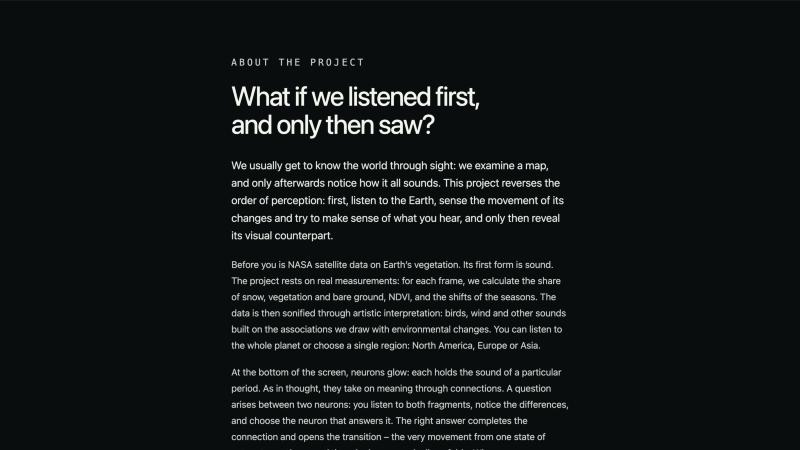

# The Earth Information Jukebox

**Listen to the Earth first — then see it.**

A web game that turns NASA satellite data on Earth's vegetation into sound. You hear the seasons change across a continent — snow, spring thaw, summer green, autumn — and only then does the picture appear. It is built so that **blind and low‑vision people can play it with sound and the keyboard alone**.

Made by **Frog Coders** for the [NASA Space Apps Challenge 2026: *The Earth Information Jukebox*](https://www.spaceappschallenge.org/2026/challenges/the-earth-information-jukebox/).

| Start screen | The game | About |
|---|---|---|
|  |  |  |

- **Demo video:** _link will be added here_
- **Run it:** see [Run locally](#run-locally) (no public hosting yet)

---

## What it does

1. **Choose a region** — Whole Earth, North America, Europe or Asia.
2. **Six “neurons”** glow at the bottom of the screen: six months 180 days apart, from December 2023 to June 2026. Each one holds the sound of that moment.
3. **Five questions**, one for each pair of neighbouring neurons — for example *“Where is nature asleep?”* or *“Where do the birds have more to say?”*. You listen to both months and pick one. A right answer connects the neurons, plays the 180‑day transition between them, and unblurs the NASA video for that period.
4. **The Bell** is the human voice in this world. Press **Space** at any time and nature answers for the current pair — no question needed. A blind player can open the whole story with the Bell alone.
5. When all five links are made, **Enter** plays the full sonification, December 2023 – June 2026.

The essay behind the idea is on the third screen of the site ([frontend/index.html](frontend/index.html), section `#about`).

## Accessibility

- Every action has a key, chosen so it doesn't clash with NVDA / JAWS / VoiceOver browse mode:

  | Key | Action |
  |---|---|
  | `Space` | ring the Bell — nature opens the next period |
  | `Enter` | listen to the whole story, 2023–2026 |
  | `1` / `2` | choose the first or second month |
  | `R` | replay the last opened period |
  | `Esc` | stop the sound |

- Screen‑reader announcements (`aria-live`) for every state change; a synthesized voice speaks only the time periods (e.g. “December 2023 — June 2024”), so the sound stays the main channel.
- Large question text, high contrast, no time pressure, no penalty for a wrong answer.
- The sound mixer lets you turn layers (wind, chimes, birds, music) up, down or off.

## How the data becomes sound

```
NASA NDVI video (SVS 5544)
   │  pipeline/  — OpenCV: crop a region, read every frame, map colours to the NDVI colour bar
   ▼
features per frame (data/features/<region>.json)
   │  share of snow, bare ground, light / deep green, mean NDVI, speed of greening …
   ▼
sonify/  — rule-based composer “seasons”: a deterministic score (no randomness)
   ▼
backend/ (FastAPI)  →  frontend/ (Tone.js plays the score in sync with the video)
```

| Phenomenon in the data | What you hear |
|---|---|
| ❄ Snow (`white_frac`) | a whistling blizzard; the more snow, the denser it gets, with a low drone |
| 💧 Snow melting in spring | dripping water — more drops the faster the snow disappears |
| 🌱 Vegetation growing / declining (`green_up_rate`) | a warm flute rises in spring and falls in autumn |
| 🌿 Green land (`green_frac`, `ndvi_mean`) | wind chimes — silent below 20 % green, clearer and brighter with higher NDVI |
| ☀ Summer | warm wind and birdsong (birds follow the share of green) |
| 🍂 Autumn, bare ground (`earth_frac`) | dry wind and sparse wooden clicks; the wind gets quieter over bare land |
| Winter ↔ summer | the harmony moves from D minor to F major |

Musical frame: 72 BPM, D–F–G–A–C pentatonic, thresholds with hysteresis so sounds don't flicker. Each region is auto‑calibrated to its own range of values ([sonify/auto.py](sonify/auto.py)). Full sound design: [docs/sound-design.md](docs/sound-design.md) (in Ukrainian).

> This is an artistic sonification for exploring and learning, not a scientific measurement. Values are estimated from the colours of the visualization, and near‑real‑time satellite data may contain clouds and gaps.

## Run locally

Requires Python 3.12+ and a modern browser (Chrome, Edge, Firefox or Safari).

```bash
git clone https://github.com/Popop3325/The-Earth-Information-Jukebox.git
cd The-Earth-Information-Jukebox
python3 -m venv .venv
.venv/bin/pip install -r requirements.txt
```

Download the NASA video (≈ 60 MB, not stored in git):

```bash
curl -L --create-dirs -o data/raw/ndvi_global.mp4 https://svs.gsfc.nasa.gov/vis/a000000/a005500/a005544/nrt_ndvi_equi_2048p30.mp4
```

Compute the features for all regions (a few seconds each):

```bash
.venv/bin/python -m pipeline.run_all
```

Start the server and open <http://127.0.0.1:8000>:

```bash
.venv/bin/uvicorn backend.main:app
```

On Windows use `.venv\Scripts\python` and `.venv\Scripts\uvicorn` instead of `.venv/bin/...`.

## Project structure

| Folder | What's inside |
|---|---|
| `pipeline/` | video → per‑frame features (OpenCV, NumPy) |
| `sonify/` | the composer: features → score (`seasons.py`, `presets.json`, `auto.py`) |
| `backend/` | FastAPI: `/api/videos`, `/api/features/<id>`, `/api/score/<id>`, static files |
| `frontend/` | the game: `index.html`, `neuro/` (game logic, UI, 3D globe), `player.js` (Tone.js score player), `sounds/` |
| `data/` | region catalog (crop and coordinates), frame dates, NDVI colour bar; video and computed features are not in git |
| `shared/` | JSON schemas of the features and the score |
| `docs/` | architecture, sound design, team notes (mostly in Ukrainian) |

## NASA data

- **NASA Scientific Visualization Studio — [Near Real-Time NDVI (SVS 5544)](https://svs.gsfc.nasa.gov/5544/)**, from the VIIRS instrument on the Suomi NPP satellite, 27 December 2023 – 13 June 2026, one frame per day.
- This single video is the only data source. Every sound, the video on screen and the 3D globe come from it: the globe is one frame of this video wrapped onto a sphere.

## Credits

- **Sounds:** “[Sounds of the forest and the settlement](https://freesound.org/people/dibko/sounds/801278/)” by dibko ([CC BY 4.0](https://creativecommons.org/licenses/by/4.0/)); “[Gust of Wind 7](https://freesound.org/people/kwahmah_02/sounds/259246/)” by kwahmah_02 ([CC BY 3.0](https://creativecommons.org/licenses/by/3.0/)). Both via freesound.org, edited (excerpt, loop, volume, AAC). Details: [frontend/sounds/CREDITS.md](frontend/sounds/CREDITS.md). All other sounds are synthesised in the browser.
- **Libraries:** [Tone.js](https://tonejs.github.io/), [three.js](https://threejs.org/), [FastAPI](https://fastapi.tiangolo.com/), [OpenCV](https://opencv.org/), NumPy, pandas.

## Use of AI

- **Code:** written with the help of an AI coding assistant (Claude by Anthropic). The team designed the game, the questions, the sound mapping and the interface, and tested and directed every change; the assistant wrote and edited most of the code.
- **Sounds:** the synthesized sounds (blizzard, chimes, drips, wood, flute, drone, Bell) are generated by that code, so they are AI‑assisted as well. The two recordings above are by human authors.
- **Text:** the project essay was written by the team without AI; only its translation into English was automated.
- **Images and video:** none are AI‑generated — everything visual comes from the NASA video.
- No NASA logos or branding are used.

## Team — Frog Coders

| Name | GitHub |
|---|---|
| Oleksii Lytvyn | [@Popop3325](https://github.com/Popop3325) |
| Karina Avramenko | [@karina-avramenko](https://github.com/karina-avramenko) |
| Daria Shuryha | [@Kitsune289666](https://github.com/Kitsune289666) |
| Nikita Melnikov | [@antid3li](https://github.com/antid3li) |
| Fedir Dovhopol | [@FedirTop](https://github.com/FedirTop) |

## License

Code: [MIT](LICENSE). Sound recordings keep their own Creative Commons licenses (see Credits). NASA SVS imagery is used under NASA's [media usage guidelines](https://www.nasa.gov/nasa-brand-center/images-and-media/).
